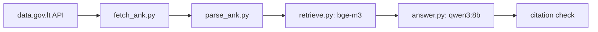

# LitLex-LT-v2


Question answering for the Lithuanian Code of Administrative Offences (Administracinių nusižengimų kodeksas, ANK). You ask a question in Lithuanian, the system finds the matching article parts in the official text and answers with citations. If the law does not answer the question, it says "Atsakymo į šį klausimą ANK nerasta." (no answer found in ANK).

This is the next version of [LitLex v1](https://github.com/lukamaga/LitLex-Llama-LT-AI), a fine-tuned Llama 3 8B that answered from memory and often cited the wrong article. Made for the Large Language Models course at Vilnius University, 2026.

**Status:** mid-term version. It works end to end and is tested on 20 dev questions. The test set is not ready yet.

## How it works



1. **Data.** Two versions of ANK from the data.gov.lt API: valid on 2026-01-12 (close to the text LitLex v1 was trained on) and valid from 2026-11-01.
2. **Parsing.** The law is split into article parts. Each part gets an ID like `488(1)` or `342-1(2)` (article 342¹, part 2).
3. **Search.** The embedding model bge-m3 finds the 5 parts closest to the question. The 2026-11-01 version is used by default.
4. **Answer.** The LLM qwen3:8b reads these 5 parts and returns JSON: whether they answer the question, the cited part IDs (only these 5 are allowed), a quote, the answer and the fine in euros.
5. **Citation check.** The answer is shown only if it cites at least one part and every cited part came from the search. Otherwise you get the "not found" sentence.

## Setup

You need Python 3.12+ and [Ollama](https://ollama.com), which runs both models on your own computer.

```bash
git clone https://github.com/lukamaga/LitLex-LT-v2.git
cd LitLex-LT-v2
python3 -m venv .venv
.venv/bin/pip install -r requirements.txt -r requirements-dev.txt
ollama pull bge-m3
ollama pull qwen3:8b
```

- Run all commands from the repo folder.
- Check `python3 --version`. On macOS it is often 3.9, then install 3.12 (for example `brew install python@3.12`) and use `python3.12 -m venv .venv`.
- Ollama has to be running: open the Ollama app or run `ollama serve` in another terminal.
- `requirements-dev.txt` only has pytest for the tests.
- The law texts and the parsed parts are already in `data/`, so nothing else has to be downloaded.

To check the install (no Ollama needed):

```bash
.venv/bin/python -m pytest -q tests
```

The tests check the parser, Lithuanian number words, the version comparison, the search ranking, the citation check, the scoring and the question checks.

## Usage

Ask a question ("Neighbours play loud music at night. What fine can they get?"):

```bash
.venv/bin/python src/answer.py "Kaimynai naktį garsiai leidžia muziką. Kokia bauda jiems gali būti skirta?"
```

The first run for each version builds the search index (about a minute on an M3 Max) and saves it to `data/index/`. Options:

- `--version 2026-01-12` searches the older version;
- `--no-strict` also shows answers that fail the citation check;
- `--keep-loaded` keeps the models in memory, so the next question starts faster.

To see only what the search finds:

```bash
.venv/bin/python src/retrieve.py "ANK 416 str. 6 d."
```

## Results on the dev set

| | result |
|---|---|
| search: right part ranked first (hit@1) | 12/18 |
| search: right part in the top 5 (recall@5) | 13/18 |
| correct answers (right part and fine) | 10/16 |
| said "not found" when ANK has no answer | 2/2 |

The 20 dev questions are 16 normal ones, 2 that ANK cannot answer and 2 with an injected instruction. Search is scored on the 18 questions that have a right part. The 2 injected ones are left out of the answers for now and will be tested in the final version.

Most wrong answers come from the search: with everyday words instead of legal ones, bge-m3 ranks the right part first only for 2 of 6 questions. Full tables are in `results/`.

## Comparison without search (optional)

`src/reference.py` asks the same questions to models that do not search the law. An answer counts as correct if its text names the right part and the first fine it gives is the right one.

| model | correct |
|---|---|
| Llama 3 8B (base of LitLex v1) | 0/16 |
| LitLex v1 | 0/16 |
| qwen3:8b without search | 0/16 |
| qwen3:8b with bge-m3 (this system) | 9/16 |

Here it is 9, not 10, because one correct answer names the part only in its JSON, not in the text.

You do not need this to use the system, the saved outputs are already in `results/`. The qwen3:8b run only needs Ollama (`report` builds the table from the saved outputs):

```bash
.venv/bin/python src/reference.py closed --split dev
.venv/bin/python src/reference.py report --split dev
```

The Llama models need a second environment, about 64 GB of free disk and about 16 GB of RAM, because the LitLex v1 adapter is merged into the base model on the CPU first:

```bash
python3.12 -m venv .venv-v1
.venv-v1/bin/pip install -r requirements-v1.txt
.venv-v1/bin/hf download unsloth/llama-3-8b --include "*.json" --include "*.safetensors" --local-dir ollama/llama-3-8b
.venv-v1/bin/hf download lukashm/LitLex-Llama-LT-v1 --local-dir ollama/litlex-v1-adapter
.venv-v1/bin/python ollama/merge_v1.py
cd ollama && ollama create llama3-8b-base -f llama3-8b-base.Modelfile && ollama create litlex-v1 -f litlex-v1.Modelfile && cd ..
.venv/bin/python src/reference.py base --split dev
.venv/bin/python src/reference.py v1 --split dev
.venv/bin/python src/reference.py report --split dev
```

## Questions and evaluation

Questions are written in `questions/questions.xlsx`. It has four sheets: Questions (your rows), Articles (every part with its fines), Changes (what changed between the versions) and Instructions (what every column means).

```bash
.venv/bin/python src/questions.py build      # check the rows, write dev.jsonl and test.jsonl
.venv/bin/python src/questions.py freeze     # lock the test set (once it is written)
.venv/bin/python src/evaluate.py retrieval --split dev
.venv/bin/python src/evaluate.py answers --split dev
```

`build` writes nothing if a row is wrong, for example if the right part does not exist or the fine is not in that part. It also stops on questions copied from the LitLex v1 training data. After `freeze`, `build` refuses to change the test set. Note that these commands overwrite the saved files in `questions/` and `results/`.

Other commands: `questions.py refresh` rebuilds the Articles, Changes and Instructions sheets and keeps your questions, `questions.py show "99(1)"` prints one part with its fines, `evaluate.py rescore --split dev` scores the saved answers again without the models.

## Answer verdicts

```bash
.venv/bin/python src/export_answers.py --split dev
```

Writes `results/answers.json` and `results/chunks.json`. Every answer gets a verdict (correct, correct_refusal, retrieval_failure, wrong_refusal, generation_failure, citation_failure or false_answer) and one sentence why. `results/judge_report.json` is what the course judge script (qwen3:8b) said about these files: it agreed with us on whether the answer is right for 12 of 13 answers, and on whether the citations support it for 10 of 10.

## Rebuild the data (optional)

```bash
.venv/bin/python src/fetch_ank.py              # download both versions to data/raw/
.venv/bin/python src/parse_ank.py 2026-01-12   # split into parts, write data/processed/
.venv/bin/python src/parse_ank.py 2026-11-01
.venv/bin/python src/diff_versions.py          # list what changed between the versions
```

The API text loses superscripts, so article 342¹ comes as "3421". The parser fixes this from the order of the articles. If an article has several wordings with different dates, it keeps the one valid on the version date.

## License

- Code: MIT, see `LICENSE`.
- ANK text: Register of Legal Acts through [data.gov.lt](https://data.gov.lt), CC BY 4.0. Legal acts are not protected by copyright in Lithuania (Law on Copyright and Related Rights, Art. 5).
- Questions: CC BY 4.0.
- Models: bge-m3 (MIT) and Qwen3 (Apache 2.0), run with Ollama.

This is a study project, not legal advice. Check the official text on [e-tar.lt](https://www.e-tar.lt).
